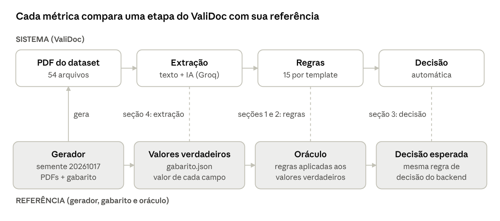

# ValiDoc — Roteiro de Testes com Dataset Sintético

Outubro de 2026 · preparado por Ivan Luiz Pedroso Pires para os testes do TCC de Gabriel Guedes

## 1. Objetivo e escopo

Este roteiro mede se o ValiDoc encontra erros conhecidos em documentos acadêmicos. O teste roda um dataset sintético de Diários de Turma e Planos de Curso, cada um com erros propositais registrados em gabarito. Os resultados entram na seção de testes do TCC.

O teste cobre quatro perguntas:

1. **Detecção:** as regras do template reprovam ou pendenciam os documentos com erro?
2. **Falso alarme:** os documentos corretos (controles) passam sem pendência?
3. **Robustez:** o sistema trata corretamente PDF sem texto, PDF corrompido, arquivo que não é PDF e reenvio duplicado?
4. **Limites:** quais erros o motor de regras atual não consegue ver?

O escopo é o pipeline real do sistema: extração em duas camadas (texto + IA), os quatro tipos de regra (campo obrigatório, formato, intervalo, cálculo) e a decisão automática (`reprovado_automatico`, `aguardando_revisao`). Fora do escopo: assinatura gov.br, dossiês e validade de documentos.

Todos os nomes, matrículas, códigos e datas do dataset são fictícios e gerados aleatoriamente. Cada página traz o rodapé "Documento sintético - dados fictícios gerados para testes do ValiDoc".

## 2. O dataset

O dataset tem 54 arquivos: 50 PDFs que imitam o SIGAA (14 corretos e 36 com erros) e 4 arquivos de robustez. Tudo fica nesta pasta (`testes/dataset-validacao`).

O layout copia exemplos reais: 3 Diários de Turma de 2023.2 e 44 Planos de Curso de 2023.2 e 2025.1 da FACET/UNEMAT. Ficaram iguais os rótulos, a ordem das seções, as tabelas e o cabeçalho. Os brasões oficiais foram trocados por um emblema genérico. Os documentos reais **não** estão no repositório, porque contêm dados pessoais de alunos.

| Pasta | Conteúdo | Arquivos |
|---|---|---|
| `pdfs/planos/` | Planos de Curso, 2 páginas cada | 25 (7 controles, 18 com erro) |
| `pdfs/diarios/` | Diários de Turma, 6 páginas cada: capa, docente e código de verificação, versões, notas e faltas, frequência (paisagem), conteúdo programado | 25 (7 controles, 18 com erro) |
| `pdfs/robustez/` | PDF escaneado sem texto, PDF corrompido, texto com extensão `.pdf`, cópia idêntica de um diário | 4 |
| `gabarito/` | `gabarito.csv` (um erro por linha) e `gabarito.json` (erros + valor verdadeiro de cada campo) | 2 |
| `templates/` | Campos, rótulos e regras dos dois templates | 2 |
| `scripts/` | `criar_templates.py`, `executar_testes.py`, `oraculo.py`, `calcular_metricas.py` | 4 |
| `gerador/` | `gerar_dataset.py`, que produz os PDFs e o gabarito | 1 |

**Como os dados foram sorteados.** Cada documento recebe uma disciplina de um catálogo de 12 (Banco de Dados I, Redes, Compiladores etc.), código `FACET-SNP-2xx/3xx`, semestre entre 2024.1 e 2025.2, de 2 a 6 créditos (carga = créditos × 15 h) e horário no padrão do SIGAA (ex.: `3N123`). Docentes e alunos têm nomes combinados ao acaso. Cada diário tem de 8 a 14 alunos com notas, faltas, médias e resultado (APR, REP, REPF, REMF) coerentes entre si: a soma da frequência bate com o total de faltas, e mais de 25% da carga em faltas reprova.

**Nomes neutros.** Os arquivos se chamam `P01_Plano_de_Curso_...` e `D01_diario_...` e não revelam o erro. A ordem é embaralhada. Abra o gabarito só depois de rodar o teste.

**Regenerar.** `python gerador/gerar_dataset.py` reproduz o mesmo conteúdo com a semente `20261017`. Com `--seed <número>` sai um sorteio novo, com outro gabarito. Exige `reportlab` e o `pdftoppm` (pacote poppler-utils).

## 3. Erros propositais e gabarito

O dataset injeta 30 tipos de erro em 36 documentos, 42 ocorrências no total: 32 cobertas por regras determinísticas, 7 por regras que dependem de uma contagem feita pela IA e 3 que nenhuma regra cobre. Três documentos de cada tipo trazem dois erros ao mesmo tempo. O `gabarito/gabarito.csv` lista cada ocorrência com o arquivo, o local exato e o detalhe (por exemplo, "código impresso: FACE-SNP-204").

O sistema devolve um status por regra, e a decisão do documento sai deles:

| Status da regra | Significado | Efeito na decisão |
|---|---|---|
| `aprovado` | Valor presente e dentro do critério | Nenhum |
| `nao_conforme` | Valor presente e fora do critério | Documento `reprovado_automatico` |
| `nao_encontrado` | Campo vazio ou ausente | Documento inconclusivo (`aguardando_revisao`) |
| `nao_verificavel` | Valor lido mas sem evidência ou inválido na normalização | Inconclusivo |
| `extracao_conflitante` | Texto e IA leram valores diferentes | Inconclusivo |

**Classes de erro.** *regra*: uma regra determinística (campo obrigatório, formato, intervalo ou cálculo) deve acusar o erro. *ia*: a regra é um intervalo sobre uma quantidade que a IA conta na tabela (ex.: alunos sem total de faltas, que deve ser 0). *limitacao*: o motor atual avalia campos isolados e não compara linhas de tabela, então o erro deve passar. Essas três ocorrências existem para documentar o limite do sistema no TCC.

### Plano de Curso (regras RP01 a RP15)

| Erro | Descrição | Onde | Regra | Classe | Status esperado |
|---|---|---|---|---|---|
| EP01 | Ementa em branco | Pág. 1, Ementa | RP01 | regra | `nao_encontrado` |
| EP02 | Docente e matrícula em branco | Pág. 1, Docente(s) | RP02 | regra | `nao_encontrado` |
| EP03 | Horário de atendimento em branco | Pág. 2 | RP03 | regra | `nao_encontrado` |
| EP04 | Pré-requisitos em branco (o SIGAA imprime "Não possui") | Pág. 1 | RP04 | regra | `nao_encontrado` |
| EP05 | Metodologia em branco | Pág. 2 | RP05 | regra | `nao_encontrado` |
| EP06 | Procedimentos de avaliação em branco | Pág. 2 | RP06 | regra | `nao_encontrado` |
| EP07 | Referências básicas sem nenhum item | Referências Básicas | RP07 | regra | `nao_encontrado` |
| EP08 | Código fora do padrão (`FACET-SNP-29X`, `FACE-SNP-204`) | Pág. 1, Turma | RP08 | regra | `nao_conforme` |
| EP09 | Semestre inexistente (`2025.3` e `2024.3`) | Pág. 1, Turma | RP09 | regra | `nao_conforme` |
| EP10 | Horário inválido (`9N123`: dia 9 não existe) | Pág. 1, Horário | RP10 | regra | `nao_conforme` |
| EP11 | Matrícula do docente com 6 ou 7 dígitos | Pág. 1, Matrícula | RP11 | regra | `nao_conforme` |
| EP12 | Nenhuma avaliação cadastrada | Avaliações | RP12 | regra | `nao_encontrado` |
| EP13 | Carga horária do docente ≠ carga da disciplina | Pág. 1 | RP13 | regra | `nao_conforme` |
| EP14 | Cronograma com apenas 4 aulas | Cronograma | RP14 | ia | `nao_conforme` |
| EP15 | Data de avaliação impossível (31/09) | Avaliações | RP12 | regra | `nao_verificavel` |

### Diário de Turma (regras RD01 a RD15)

| Erro | Descrição | Onde | Regra | Classe | Status esperado |
|---|---|---|---|---|---|
| ED01 | Código de verificação ausente | Pág. 2 | RD11 | regra | `nao_encontrado` |
| ED02 | Código de verificação fora do formato (`0276-BC25`) | Pág. 2 | RD11 | regra | `nao_conforme` |
| ED03 | Turma com status ABERTA | Cabeçalho | RD02 | regra | `nao_conforme` |
| ED04 | Data de emissão inexistente (`32/12/2025`) | Cabeçalho | RD01 | regra | `nao_verificavel` |
| ED05 | Carga horária ≠ créditos × 15 (4 créditos com 75 h; 6 créditos com 105 h) | Pág. 1 | RD06 | regra | `nao_conforme` |
| ED06 | 12 créditos (fora de 1 a 8) | Pág. 1 | RD05 | regra | `nao_conforme` |
| ED07 | Nome da disciplina em branco em todas as páginas | Pág. 1 e listas | RD03 | regra | `nao_encontrado` |
| ED08 | Docente em branco; o nome segue na tabela Versões como usuário | Pág. 2 | RD09 | regra | `nao_encontrado` |
| ED09 | Faltas não lançadas: 2 alunos sem marcação na frequência e sem total | Págs. 4 e 5 | RD13 | ia | `nao_conforme` |
| ED10 | Nota não lançada (2ª ou 3ª avaliação vazia) | Pág. 4 | RD14 | ia | `nao_conforme` |
| ED11 | 2 aulas sem descrição no conteúdo programado | Pág. 6 | RD15 | ia | `nao_conforme` |
| ED12 | Tabela Versões sem registro | Pág. 3 | RD12 | regra | `nao_encontrado` |
| ED13 | Total de faltas ≠ soma da frequência | Págs. 4 e 5 | — | limitacao | `aprovado` |
| ED14 | Aluno com média 8,2 e 12 faltas (limite 15) marcado REP | Pág. 4 | — | limitacao | `aprovado` |
| ED15 | Média final errada (8,2 impressa como 5,2) | Pág. 4 | — | limitacao | `aprovado` |

EP15 e ED04 dependem do modo de envio. No upload, a normalização de datas recusa o valor e a regra fica `nao_verificavel`. Na aba Teste do Studio não há normalização: a regex aceita `31/09` e o erro passa, e `32/12/2025` vira `nao_conforme`. ED08 testa se a IA confunde o usuário da versão com o docente.

### Robustez

| Caso | Arquivo | Resultado esperado |
|---|---|---|
| RB01 | `R01_diario_escaneado_sem_texto.pdf`: páginas como imagem | Status `erro_extracao`, "PDF sem texto selecionável" |
| RB02 | `R02_plano_corrompido.pdf`: arquivo cortado em 55% | Falha tratada (`erro_extracao` ou erro HTTP), sem travar a fila |
| RB03 | `R03_nao_e_pdf.pdf`: texto com extensão `.pdf` | HTTP 415, "O arquivo enviado não é um PDF válido" |
| RB04 | `R04_copia_identica_de_D02_...pdf` | HTTP 200 com `reenviado=true` e o mesmo id do original, sem registro duplicado |

## 4. Criar os templates

Crie dois templates, um por tipo de documento, cada um com 15 regras. Recomendo criar à mão no Studio, porque isso também testa a interface e rende capturas de tela para o TCC. O script `criar_templates.py` faz o mesmo pela API e serve de plano B ou para recriar rápido.

**Pré-requisitos.** Usuário com perfil admin ou dono da empresa (só eles gerenciam templates) e que possa enviar documentos (perfil `usuario` ou `admin`). Ambiente: `https://validoc.ivanpires.dev` ou local em `http://localhost:3333`, com `GROQ_API_KEY` configurada; sem ela a IA não extrai e quase tudo vira pendência.

### Opção A — no Studio (recomendada)

1. Em **Templates**, clique em **+ Novo modelo**, informe o nome exato (`Plano de Curso - SIGAA (testes)` ou `Diário de Turma - SIGAA (testes)`) e crie.
2. Passo **Informações**: cole a descrição do campo `descricao` do JSON em `templates/`. A IA recebe esse texto como contexto, então não resuma.
3. Passo **Campos**: cadastre os campos das tabelas abaixo. O **identificador** tem de ser igual ao da tabela, porque as regras apontam para ele. O **rótulo** é o que a IA lê para achar o valor.
4. Passo **Regras**: cadastre as 15 regras na ordem, com o nome começando pelo código (`RP01 - ...`). Os scripts de métrica identificam a regra por esse prefixo. Marque todas como obrigatórias.
5. Passo **Teste**: envie um controle (`P03` para o plano, `D02` para o diário). As 15 regras devem sair aprovadas. Se alguma falhar, revise identificador e regex antes de seguir.
6. Passo **Revisão**: publique. Tire captura de cada passo para o apêndice.
7. Anote os ids dos dois templates (estão na URL `/templates/<id>`) em `resultados/templates_criados.json`, no formato `{"api": "https://validoc.ivanpires.dev", "templates": {"Plano de Curso - SIGAA (testes)": "<id>", "Diário de Turma - SIGAA (testes)": "<id>"}}`.

### Opção B — por script

```bash
cd testes/dataset-validacao
python -m venv .venv && source .venv/bin/activate
pip install -r requirements.txt
export VALIDOC_API=https://validoc.ivanpires.dev
export VALIDOC_EMAIL=seu-email VALIDOC_SENHA=sua-senha
python scripts/criar_templates.py
```

O script cria os dois templates, cadastra campos e regras, publica a versão 1.0 e grava os ids em `resultados/templates_criados.json`. Se já existir um template com o mesmo nome, ele reaproveita.

### Template do Plano de Curso

| Identificador | Rótulo | Tipo |
|---|---|---|
| `codigo_disciplina` | Código da disciplina (início do campo Turma, ex.: FACET-SNP-310) | texto |
| `nome_disciplina` | Nome da disciplina | texto |
| `carga_horaria` | Carga horária da disciplina em horas, só o número (valor entre parênteses no campo Turma) | numero |
| `turma` | Número da turma | texto |
| `ano_semestre` | Ano/semestre entre parênteses no fim do campo Turma (ex.: 2025.1) | texto |
| `horario` | Horário | texto |
| `pre_requisitos` | Pré-Requisitos | texto |
| `ementa` | Ementa (copie as primeiras palavras exatamente como no documento) | texto_longo |
| `matricula_docente` | Matrícula do docente | texto |
| `docente` | Nome do docente em Docente(s), sem a carga horária | texto |
| `carga_horaria_docente` | Carga horária do docente em horas, só o número (após o nome em Docente(s)) | numero |
| `metodologia` | Metodologia (copie as primeiras palavras exatamente como no documento) | texto_longo |
| `procedimentos_avaliacao` | Procedimentos de Avaliação da Aprendizagem (copie as primeiras palavras exatamente como no documento) | texto_longo |
| `horario_atendimento` | Horário de Atendimento (copie as primeiras palavras exatamente como no documento) | texto |
| `data_primeira_aula` | Data de início da primeira linha do Cronograma de Aulas | data |
| `qtd_aulas_cronograma` | Quantidade de linhas da tabela Cronograma de Aulas, só o número | numero |
| `data_primeira_avaliacao` | Data da primeira linha da tabela Avaliações | data |
| `referencia_basica` | Descrição da primeira linha da tabela Referências Básicas (copie as primeiras palavras exatamente) | texto |

| Regra | Tipo | Parâmetros |
|---|---|---|
| RP01 - Ementa preenchida | campo_obrigatorio | campo `ementa` |
| RP02 - Docente informado | campo_obrigatorio | campo `docente` |
| RP03 - Horário de atendimento informado | campo_obrigatorio | campo `horario_atendimento` |
| RP04 - Pré-requisitos informados | campo_obrigatorio | campo `pre_requisitos` |
| RP05 - Metodologia preenchida | campo_obrigatorio | campo `metodologia` |
| RP06 - Procedimentos de avaliação preenchidos | campo_obrigatorio | campo `procedimentos_avaliacao` |
| RP07 - Referência básica cadastrada | campo_obrigatorio | campo `referencia_basica` |
| RP08 - Código da disciplina no padrão FACET-SNP-000 | formato | campo `codigo_disciplina`, regex `^FACET-SNP-\d{3}$` |
| RP09 - Ano/semestre válido | formato | campo `ano_semestre`, regex `^\d{4}\.[12]$` |
| RP10 - Código de horário válido | formato | campo `horario`, regex `^[2-7]{1,3}[MTN][1-6]{1,6}$` |
| RP11 - Matrícula do docente com 9 dígitos | formato | campo `matricula_docente`, regex `^\d{9}$` |
| RP12 - Data da 1ª avaliação válida | formato | campo `data_primeira_avaliacao`, regex de data (abaixo) |
| RP13 - CH do docente igual à CH da disciplina | calculo | expressão `carga_horaria_docente`, resultado `carga_horaria`, tolerância 0 |
| RP14 - Cronograma com 12 a 40 aulas | intervalo | campo `qtd_aulas_cronograma`, mín. 12, máx. 40 |
| RP15 - Data da 1ª aula válida | formato | campo `data_primeira_aula`, regex de data (abaixo) |

### Template do Diário de Turma

| Identificador | Rótulo | Tipo |
|---|---|---|
| `data_emissao` | Data de emissão (após 'Diário - Emitido em') | data |
| `status_turma` | Status da Turma | texto |
| `codigo_disciplina` | Código da disciplina | texto |
| `nome_disciplina` | Nome da disciplina (campo Disciplina da capa) | texto |
| `creditos` | Créditos, só o número | numero |
| `carga_horaria` | Carga Horária, só o número | numero |
| `turma` | Turma | texto |
| `ano_semestre` | Ano/Semestre | texto |
| `horario` | Horário | texto |
| `matricula_docente` | Matrícula do docente (coluna Matrícula ao lado de Docente(s)) | texto |
| `docente` | Nome em Docente(s), sem a carga horária | texto |
| `codigo_verificacao` | Código de Verificação | texto |
| `codigo_versao` | Código da primeira linha da tabela Versões do documento | texto |
| `qtd_alunos_sem_total_faltas` | Quantidade de alunos com a coluna Total Faltas vazia na Lista de Notas e Faltas (0 se todas preenchidas) | numero |
| `qtd_alunos_sem_nota` | Quantidade de alunos com 1a, 2a ou 3a Aval. vazia na Lista de Notas e Faltas (0 se todas preenchidas) | numero |
| `qtd_aulas_sem_conteudo` | Quantidade de datas sem Descrição na tabela Conteúdo Programado (0 se todas preenchidas) | numero |

| Regra | Tipo | Parâmetros |
|---|---|---|
| RD01 - Data de emissão válida | formato | campo `data_emissao`, regex de data (abaixo) |
| RD02 - Turma consolidada | formato | campo `status_turma`, regex `^CONSOLIDADA$` |
| RD03 - Nome da disciplina informado | campo_obrigatorio | campo `nome_disciplina` |
| RD04 - Código da disciplina no padrão FACET-SNP-000 | formato | campo `codigo_disciplina`, regex `^FACET-SNP-\d{3}$` |
| RD05 - Créditos entre 1 e 8 | intervalo | campo `creditos`, mín. 1, máx. 8 |
| RD06 - Carga horária igual a créditos x 15 | calculo | expressão `creditos*15`, resultado `carga_horaria`, tolerância 0 |
| RD07 - Ano/semestre válido | formato | campo `ano_semestre`, regex `^\d{4}\.[12]$` |
| RD08 - Código de horário válido | formato | campo `horario`, regex `^[2-7]{1,3}[MTN][1-6]{1,6}$` |
| RD09 - Docente informado | campo_obrigatorio | campo `docente` |
| RD10 - Matrícula do docente com 9 dígitos | formato | campo `matricula_docente`, regex `^\d{9}$` |
| RD11 - Código de verificação com 10 caracteres hexadecimais | formato | campo `codigo_verificacao`, regex `^[0-9a-f]{10}$` |
| RD12 - Versão do documento registrada | formato | campo `codigo_versao`, regex `^[0-9a-f]{10}$` |
| RD13 - Faltas lançadas para todos os alunos | intervalo | campo `qtd_alunos_sem_total_faltas`, mín. 0, máx. 0 |
| RD14 - Notas lançadas para todos os alunos | intervalo | campo `qtd_alunos_sem_nota`, mín. 0, máx. 0 |
| RD15 - Conteúdo registrado em todas as aulas | intervalo | campo `qtd_aulas_sem_conteudo`, mín. 0, máx. 0 |

Regex de data usada em RP12, RP15 e RD01 (a mesma que o gerador de templates por IA usa):

```text
^(0[1-9]|[12][0-9]|3[01])/(0[1-9]|1[0-2])/\d{4}$
```

**Por que os rótulos são longos.** O upload só aceita um valor da IA se ele aparecer literalmente no texto do PDF. Pedir "as primeiras palavras exatamente" evita que a IA resuma a ementa e o campo caia em `nao_verificavel`. Pedir "só o número" evita `60h` onde o cálculo espera `60`.

**Experimento opcional.** Gere um terceiro template com **Gerar com IA**, enviando um controle e a mesma descrição. Compare as regras sugeridas com as 15 de referência: quantas coincidem, quais faltam, quais não são verificáveis. Rende uma tabela sobre a qualidade da geração assistida.

## 5. Validar os documentos

A medição oficial usa o upload real, em lote, pelo script. A interface entra numa amostra, para conferir que mostra o mesmo que a API e para gerar as capturas. Reserve cerca de 1 hora por rodada completa: são 54 arquivos e cada um leva de 10 a 40 segundos.

### Antes de começar

- [ ] Registrar o ambiente: URL, commit publicado (`git log -1` ou a versão no rodapé), modelo da Groq (`GROQ_MODEL`) e data. Esses dados entram no TCC.
- [ ] Rodar `python scripts/oraculo.py`. A última linha deve ser "Divergências entre oráculo e gabarito: 0".
- [ ] Conferir que `resultados/templates_criados.json` tem os dois ids.

### Passo a passo

1. **Rodada 1, upload real.** `python scripts/executar_testes.py`. O console mostra, por arquivo, o status final, a decisão, o tempo e as regras que falharam. As respostas brutas vão para `resultados/execucao_upload_<data-hora>.json`. Os arquivos de robustez são enviados por último.
2. **Rodadas 2 e 3.** Repita com `--repeticao 2` e `--repeticao 3`. A IA pode variar entre chamadas, e três rodadas mostram quanto. Reenviar o mesmo arquivo reprocessa o documento existente (`reenviado=true`), sem duplicar.
3. **Rodada no Studio.** `python scripts/executar_testes.py --modo studio`. Usa a rota de teste do template, sem normalização nem checagem de evidência. Serve para comparar os dois caminhos de extração.
4. **Amostra pela interface.** Envie pela tela **Documentos → Upload** um controle e um documento de cada classe de erro (sugestão: `P03`, `P01`, `P02`, `P07`, `D02`, `D04`, `D12`, `D16`) e os quatro de robustez. Para cada um, abra o detalhe e confira se as regras reprovadas, a explicação da IA e o parecer batem com o JSON. Capture a tela.
5. **Fluxo humano (opcional).** Com um usuário validador, abra a **Fila de validação**, revise dois inconclusivos e finalize um como aprovado e outro como reprovado. Mostra no TCC que a decisão automática não é a última palavra.

Se o script parar no meio, rode de novo com `--filtro` (ex.: `--filtro D1` processa D10 a D19) e passe todos os JSONs juntos ao `calcular_metricas.py`, ou repita a rodada inteira.

### O que observar em cada documento

| Situação | Onde ver | Anotar |
|---|---|---|
| Regra-alvo do erro | `regras.<código>.status` no JSON ou cartão da regra na tela | Status obtido x esperado no gabarito |
| Alarmes em regras que não são alvo | Demais regras não aprovadas | Critério e valor encontrado: é erro de extração ou de regra? |
| Valores extraídos | `valores` e `extracao` no JSON; Evidências na tela | Campo vazio, inventado ou divergente |
| Decisão | `status_documento` e `resultado_validacao` | Reprovado, inconclusivo ou aprovado |
| Explicação e parecer | `observacoes`, `parecer_ia`, `explicacao_ia` | Se a explicação cita o erro certo |
| Tempo | `segundos` | Inclui a espera entre consultas (3 s) |

Guarde todos os JSONs de `resultados/`: são a evidência bruta do capítulo de testes.

## 6. Métricas e registro dos resultados

O script `calcular_metricas.py` compara cada execução com três referências e gera as tabelas do TCC em `resultados/metricas_<execução>.md`. Separar as referências mostra *onde* o sistema erra: na leitura do PDF, no desenho das regras ou na decisão.



A linha de cima é o que o ValiDoc faz; a de baixo, a referência montada pelo gerador. Cada tracejado é uma comparação e indica a seção do relatório que a mede.

```bash
python scripts/calcular_metricas.py                          # última execução
python scripts/calcular_metricas.py resultados/execucao_upload_20261020-1400.json
python scripts/calcular_metricas.py parte1.json parte2.json  # une execuções parciais
```

**O oráculo.** `oraculo.py` reimplementa em Python o motor de regras do backend (`validationService.ts`) e a normalização de datas, e aplica as regras aos valores verdadeiros de cada PDF. O resultado é o status que cada regra teria com extração perfeita. Com ele, uma regra que falha num controle é falso positivo de extração, e não de regra.

### Definições

Na avaliação regra a regra, cada par documento × regra conta uma vez (50 documentos × 15 regras = 750 avaliações). Positivo é regra não aprovada.

- **VP** (verdadeiro positivo): oráculo e sistema não aprovam a regra.
- **FP** (falso positivo): o oráculo aprova e o sistema não. Alarme falso.
- **FN** (falso negativo): o oráculo não aprova e o sistema aprova. Erro que passou.
- **VN** (verdadeiro negativo): ambos aprovam.

$$\text{Precisão} = \frac{VP}{VP + FP} \qquad \text{Revocação} = \frac{VP}{VP + FN} \qquad F_1 = \frac{2 \cdot \text{Precisão} \cdot \text{Revocação}}{\text{Precisão} + \text{Revocação}}$$

$$\text{Acurácia} = \frac{VP + VN}{VP + FP + FN + VN}$$

### O que o relatório traz

| Seção do relatório | Pergunta que responde | Arquivo de detalhe |
|---|---|---|
| 1. Regras: sistema x oráculo | VP, FP, FN, VN, precisão, revocação, F1 e acurácia, no geral e por tipo de documento | `regras_*.csv` |
| 2. Detecção por erro injetado | Cada um dos 30 erros foi acusado pela regra certa e com o status esperado? Taxa por classe (regra, ia, limitacao) | `erros_*.csv` |
| 3. Decisão por documento | Quantos controles passaram limpos, quantos documentos com erro foram sinalizados; matriz esperado × obtido | — |
| 4. Extração de campos | Acurácia por campo; campos não extraídos, divergentes e inventados (valor para campo em branco) | `extracao_*.csv` |
| 5. Robustez | Os 4 arquivos problemáticos tiveram o desfecho esperado? | — |
| 6. Tempo | Média, mediana, mínimo e máximo por documento | — |

### Como consolidar as três rodadas

Rode o script para cada rodada. No TCC, apresente precisão, revocação e F1 como média ± desvio-padrão das três. Para a variação da IA, conte quantas avaliações documento × regra mudaram de status entre rodadas (compare os `regras_*.csv`). Apresente a rodada do Studio à parte, como comparação entre os dois caminhos de extração.

**Leitura dos FP e FN.** Para cada FP ou FN, abra a linha no `regras_*.csv` e o campo no `extracao_*.csv` e classifique a causa: (a) IA não achou o valor; (b) IA leu valor errado ou inventou; (c) valor certo sem evidência literal; (d) regra mal especificada. Essa tabela de causas é o que transforma números em discussão.

## 7. Texto-base para a seção de testes do TCC

O texto abaixo segue a ordem objetivo, materiais, procedimento, métricas, resultados e limitações. Os trechos entre colchetes saem do `metricas_*.md`. Ajuste a numeração ao capítulo.

### X.1 Objetivo

Os testes verificaram se o ValiDoc identifica inconsistências em documentos acadêmicos emitidos pelo SIGAA e se evita alarmes falsos em documentos corretos. Avaliaram-se quatro aspectos: a detecção de erros conhecidos, a taxa de falsos positivos, o tratamento de arquivos problemáticos e os limites do motor de regras.

### X.2 Conjunto de dados sintético

Diários de turma reais contêm nomes, matrículas, notas e faltas de estudantes, dados pessoais protegidos pela LGPD (Lei nº 13.709/2018). Além disso, documentos reais não têm gabarito: não se sabe de antemão quais erros contêm. Por isso construímos um conjunto sintético que reproduz o layout de 3 Diários de Turma e 44 Planos de Curso reais da FACET/UNEMAT, com dados fictícios sorteados por um gerador com semente fixa, o que torna o conjunto reprodutível.

O conjunto tem 50 documentos (25 planos e 25 diários). Destes, 14 são controles sem erro e 36 recebem de um a dois erros propositais, em 42 ocorrências de 30 tipos. Quatro arquivos adicionais testam robustez: PDF digitalizado sem texto, PDF corrompido, arquivo que não é PDF e reenvio de arquivo idêntico.

### X.3 Erros injetados

Os erros foram escolhidos a partir de falhas comuns no preenchimento: campos obrigatórios em branco (ementa, docente, metodologia, referências), valores fora do padrão (código da disciplina, semestre, horário, matrícula, código de verificação), inconsistências numéricas (carga horária incompatível com os créditos) e lançamentos ausentes (faltas e notas não lançadas, aulas sem conteúdo registrado). Cada erro foi associado no gabarito à regra que deveria acusá-lo e ao status esperado. Três erros (soma de faltas divergente, resultado incoerente e média calculada errada) foram incluídos sem regra correspondente, para documentar o limite do motor, que avalia campos isolados.

### X.4 Configuração

Foram criados dois templates no ValiDoc, um por tipo de documento, cada um com 15 regras: no plano, 7 de campo obrigatório, 6 de formato, 1 de intervalo e 1 de cálculo; no diário, 8 de formato, 4 de intervalo, 2 de campo obrigatório e 1 de cálculo. Os testes rodaram em [ambiente, URL e commit], com extração pelo modelo [GROQ_MODEL] na Groq, em [data].

### X.5 Procedimento

Todos os arquivos foram enviados pelo fluxo de upload, o mesmo usado em produção, por um script que registrou a resposta completa da API. O procedimento foi repetido três vezes para medir a variabilidade da extração por IA. Uma quarta execução usou a rota de teste do editor de templates, que dispensa a verificação de evidência, para comparar os dois caminhos. Uma amostra de [n] documentos foi conferida manualmente na interface.

Como referência, um oráculo reimplementou o motor de regras e o aplicou aos valores verdadeiros de cada documento. Assim separam-se as falhas de extração (o sistema leu errado) das falhas de especificação (a regra não cobre o caso).

### X.6 Métricas

Cada par documento × regra (750 avaliações por execução) foi classificado em verdadeiro positivo, falso positivo, falso negativo ou verdadeiro negativo em relação ao oráculo, considerando positiva a regra não aprovada. Calcularam-se precisão, revocação, F1 e acurácia. Mediram-se também a taxa de detecção por erro injetado, a taxa de controles aprovados sem pendência, a acurácia da extração campo a campo e o tempo de processamento.

### X.7 Resultados

Nas três execuções, o sistema obteve precisão de [média ± dp], revocação de [média ± dp] e F1 de [média ± dp]. Dos erros cobertos por regras determinísticas, [x de 32] foram detectados; dos que dependem de contagem pela IA, [x de 7]. [x de 14] controles foram aprovados sem pendência. A extração acertou [x%] dos campos, com [n] valores inventados para campos em branco. O tempo médio por documento foi de [x s].

[Tabela 1: métricas regra a regra, seção 1 do relatório. Tabela 2: detecção por erro, seção 2. Tabela 3: matriz de decisão, seção 3. Tabela 4: robustez, seção 5.]

### X.8 Discussão e limitações

[Comentar os FP e FN pela tabela de causas: IA não achou, leu errado, valor sem evidência literal ou regra mal especificada.]

O motor avalia valores isolados e não compara linhas de uma tabela. Por isso a divergência entre a soma da frequência e o total de faltas, o resultado incoerente e a média calculada errada passam sem alerta, como previsto. As verificações de lançamento (faltas, notas, conteúdo) só foram possíveis delegando à IA a contagem das linhas vazias, o que as torna dependentes do modelo. Regras de consistência entre linhas de tabela são um trabalho futuro.

### X.9 Ameaças à validade

Os documentos são sintéticos: reproduzem o layout, mas não a variedade de documentos reais, e foram gerados como PDF com texto, sem ruído de digitalização. O conjunto é pequeno (50 documentos) e de uma única instituição. Os erros foram escolhidos por quem conhecia as regras, o que tende a favorecer a detecção. A extração depende de um modelo de linguagem externo, cujo comportamento pode mudar entre versões. As três repetições e o registro do modelo usado atenuam, mas não eliminam, esse efeito.
